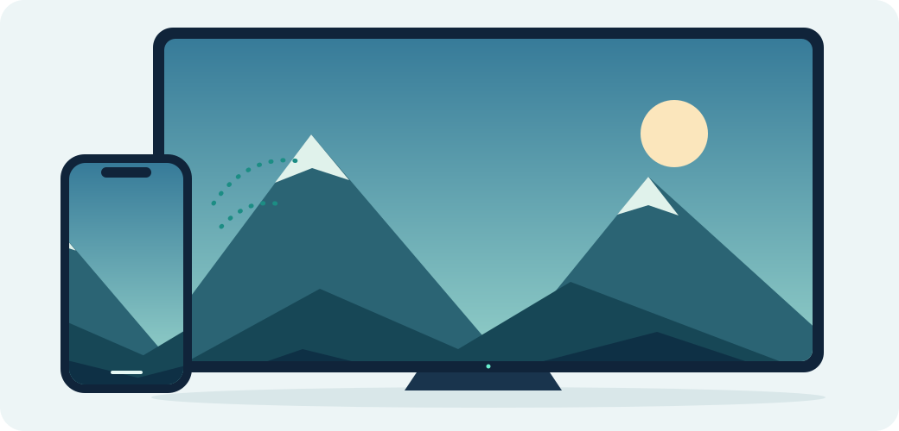

<p align="center"></p>
<h1 align="center">OpenTV-Cast</h1>
<p align="center">Your Apple screen. Your Android TV.</p>
<p align="center">An open-source AirPlay receiver for Android TV, Google TV and Android boxes.</p>
<p align="center"><a href="https://levhakobyan.github.io/OpenTV-Cast/">Download & installation</a> · <a href="INSTALL.md">Quick start</a> · <a href="CONTRIBUTING.md">Contribute</a> · <a href="LICENSE">GPL-3.0</a></p>



OpenTV-Cast lets an Android TV or box receive screen mirroring and supported audio/video streams from an iPhone, iPad or Mac on the same local network. No companion iPhone app or OpenTV-Cast account is required. It builds on [android-airplay-server](https://github.com/jqssun/android-airplay-server) and [UxPlay](https://github.com/FDH2/UxPlay); this is a downstream project, with their work and licenses preserved.

## Try the preview

**[Download OpenTV-Cast 0.2.1](https://github.com/levhakobyan/OpenTV-Cast/releases/tag/v0.2.1)** — a universal, debug-signed test APK, not a production release. The APK, checksums and full source archive are attached to the release.

1. Install the APK on your Android TV or box. Android will ask you to allow installation from the browser or file manager you use.
2. Open **OpenTV-Cast**, start the receiver, and connect both devices to the same local network.
3. On iPhone/iPad, open **Control Center → Screen Mirroring → OpenTV-Cast**. On macOS, use **Control Center → Screen Mirroring**.

You can also copy the APK by USB or install with `adb install -r`. See the [installation guide](INSTALL.md) for upgrades and troubleshooting. A web link downloads the APK; Android still requires you to confirm installation.

## What it supports

| Capability | Current scope |
| --- | --- |
| AirPlay screen mirroring | iPhone, iPad and macOS sender support inherited from UxPlay; validate your device combination |
| Audio and video | Supported AirPlay streams, HLS video and media controls; protected content is unsupported |
| TV controls | Remote navigation, receiver naming, optional PIN, resolution/frame-rate and latency settings |
| Android installation | API 23+; native ARM64, ARM32 and x86_64 in one APK |
| Google Cast | Experimental Cast Connect integration only; requires external setup and a compatible sender. **Not a Chromecast replacement.** |

Android TV/Google TV is the target. Samsung Tizen and LG webOS cannot install this APK. Network discovery needs multicast and direct local connections; isolated guest networks may prevent discovery.

## Preview status

Version 0.2.1 introduces the OpenTV-Cast name and icon. The 0.2 series decouples mirroring decoder output from network input and moves frame callbacks off the main thread, to address jerky motion. Unit tests, renderer lifecycle checks, Android builds and emulator smoke checks have passed; smoothness on physical TVs still needs measurement. No universal TV compatibility or Apple TV performance parity is claimed.

Read the [changelog](CHANGELOG.md), [verification record](VERIFICATION-0.2.0.md) and [Cast limitations](CAST_SETUP.md). Please report the TV/box model, Android version, sender/OS and connection mode when opening an issue.

## Build from source

Use JDK 21, Python 3 and the Android SDK. The project uses SDK 37, NDK `27.0.12077973` and CMake `3.22.1`.

```sh
git clone --recurse-submodules https://github.com/levhakobyan/OpenTV-Cast.git
cd OpenTV-Cast
# Set ANDROID_HOME to your SDK, or set sdk.dir in local.properties.
./gradlew :app:testDebugUnitTest :app:assembleDebug :app:lintDebug
python3 tools/tests/video_renderer_regression.py
```

Gradle downloads dependencies on the first build. The APK is produced at `app/build/outputs/apk/debug/app-debug.apk`. Native UxPlay patches are tracked under `app/src/main/cpp/patches/UxPlay` and applied by Gradle. Do not edit generated submodule changes directly. Debug builds made by different developers/CI use different signing keys and cannot necessarily upgrade each other.

For website previews, run `python3 tools/build_site.py` followed by `python3 -m http.server 8080 --bind 127.0.0.1 --directory work/site-preview`. The site has no JavaScript or third-party font dependency. [Publishing instructions](PUBLISHING.md) cover GitHub Releases and Pages.

## Open source & acknowledgements

Use, study, modify and redistribute this project under **[GNU GPL v3](LICENSE)**, subject to its terms. Preserve notices and provide the corresponding source when distributing modified binaries. Third-party components retain their respective licenses; see [THIRD_PARTY_NOTICES.md](THIRD_PARTY_NOTICES.md).

Thanks to [jqssun/android-airplay-server](https://github.com/jqssun/android-airplay-server), [UxPlay](https://github.com/FDH2/UxPlay), [FFmpeg](https://ffmpeg.org), [libplist](https://github.com/libimobiledevice/libplist), [openssl-cmake](https://github.com/viaduck/openssl-cmake), [OpenSSL](https://openssl.org), [Oboe](https://github.com/google/oboe) and [Next Player](https://github.com/anilbeesetti/nextplayer).

This project is not affiliated with or endorsed by Apple or Google. AirPlay and other product names belong to their respective owners.
